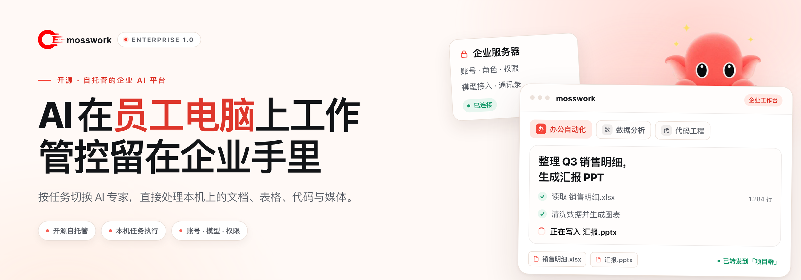

<picture>
  <source media="(prefers-color-scheme: dark)" srcset="docs/assets/readme-hero-zh-dark.png">
  
</picture>

<h1>mosswork</h1>

桌面客户端：<strong>mosswork</strong> · 服务端：<strong>moss-server</strong>

<strong>AI 在员工电脑上工作，账号、模型与权限留在企业手里。</strong>

  
  
  
  
  

  <a href="docker/enterprise/README.md">企业部署</a> ·
  <a href="docs/enterprise-client.md">客户端使用</a> ·
  <a href="docs/user-guide.md">员工上手</a> ·
  <a href="CONTRIBUTING.md">参与开发</a> ·
  <a href="README_EN.md">English</a>

开源、自托管的企业 AI 工作与协作平台。每位员工都能按任务切换 AI 专家，让 AI 在本机读写文档、表格与代码，处理图像和音视频；再通过企业通讯录、私聊和群组，把成果转发给同事。项目文件保存在员工自己的电脑上，账号、模型与权限由企业统一管理。

## 为什么选择 mosswork

| 给员工                                                                                                        | 给企业 IT                                                                                                    | 给团队                                                                                                                  |
| :------------------------------------------------------------------------------------------------------------ | :----------------------------------------------------------------------------------------------------------- | :---------------------------------------------------------------------------------------------------------------------- |
| **一个工作台，按任务切换专家** 文档、表格、代码和媒体在同一个窗口里完成，成果直接落回项目目录。 | **企业资源统一分配** 按部门限定专家与技能范围，为员工分配可用资源，员工无需各自管理模型密钥。 | **成果在通讯录、私聊和群组之间流动** 把 AI 产出转给同事，或交给另一个专家继续处理。 |

## 功能一览

| 工作                                                                                                                                                                                                                                     | 协作                                                                                                                                                                                                 | 管理与部署                                                                                                                                                                                                                                         |
| :--------------------------------------------------------------------------------------------------------------------------------------------------------------------------------------------------------------------------------------- | :--------------------------------------------------------------------------------------------------------------------------------------------------------------------------------------------------- | :------------------------------------------------------------------------------------------------------------------------------------------------------------------------------------------------------------------------------------------------ |
| **岗位专家与技能** 使用管理员分配的专家和技能，按任务切换，统一同步专家定义与技能更新。  **本机任务与审批** 读写授权目录中的文件，运行 Python 与终端任务，处理表格、文档和代码；命中危险命令规则时，先审批再执行。  **图像、音视频与联网** 通过已配置并授权的企业服务生成和编辑图像、生成视频、识别与合成语音、联网搜索，结合本机工具处理媒体。  **长期记忆与任务记录** 从服务端召回相关记忆；连接恢复后补传任务记录，不重复执行已完成的操作。  **企业知识库** 查看已获授权或全员共享的资料，在聊天中选择知识库检索内部文档。 | **企业通讯录** 按组织架构找到同事，查看在线状态。  **私聊与群组** 公司总群、部门群、项目群，支持文字、图片和文件。  **消息与成果转发** 在专家对话、私聊和群组之间转发消息与文件；把 AI 产出交给同事或其他专家。 | **部门与员工资源分配** 统一管理账号、组织和角色，设置部门专家与技能范围，批量调整员工授权；调岗或收紧部门范围时收回越界资源。  **模型与知识库授权** 模型服务和知识库由管理员维护，按员工分配可用模型及知识库读取、检索权限。  **企业能力与配置同步** 独立授权生图、生视频、语音与联网能力，通知员工更新配置；离线重连后也能检测配置变化。  **私有化部署** 自行部署和管理服务、账号、会话与知识资料，提供服务端工作区隔离及备份恢复工具。  **服务端扩展** 定时任务、多平台 IM 通道、连接器（OAuth + MCP）、插件与 ACP 编程工具集成。 |

服务端扩展（定时任务、多平台 IM 通道、连接器、插件与 ACP）受部署、权限和隔离策略限制；本机客户端不加载外部连接器或 ACP。详见[企业客户端指南](docs/enterprise-client.md)。

## 适用场景

- **办公与资料整理**：整理表格、汇总资料、生成报告和日常文档。
- **研发与项目处理**：围绕本机代码和文件开展开发、运行项目脚本、分析日志与排查问题。
- **内容与素材制作**：生成或修改图像，处理音视频素材，将产出保存在项目目录。
- **团队知识与协作**：复用团队沉淀的专家与技能，检索企业资料，在同事与群组之间交流需求、分享成果。

## 工作方式

| 位置           | 负责                                                     |
| :------------- | :------------------------------------------------------- |
| **企业服务器** | 账号与资源授权、模型接入、专家与技能配置、知识库检索、长期记忆、会话和内部通信 |
| **员工电脑**   | 执行任务工具，保存和处理本机项目文件与成果               |
| **模型服务**   | 提供企业配置的内网或外部模型推理、图像与视频生成、语音处理等能力 |

> [!NOTE]
> 本机执行仍需连接企业服务及其配置的模型，任务上下文和工具结果会按需发送给这些服务。本机工具使用员工的系统权限，项目目录不是操作系统沙箱；跨设备查看历史不会自动同步项目文件。数据边界与使用限制见[客户端指南](docs/enterprise-client.md)。

## 快速开始

当前版本：**0.0.1**。在 [Releases](https://github.com/sudoprivacy/mosswork/releases) 下载 mosswork 客户端（macOS ARM64 DMG、Windows x64 EXE）。服务端 moss-server 使用 Docker 镜像，按[一键部署指南](docker/enterprise/INSTALL.md)安装；源码构建见[桌面说明](desktop/README.md)。

GitHub 下载较慢时，可使用[夸克网盘下载](https://pan.quark.cn/s/6da75d82a576)，选择与服务器匹配的客户端版本。

| 管理员：部署与配置                                                                                                                                                                    | 员工：登录与工作                                                                                                                              |
| :------------------------------------------------------------------------------------------------------------------------------------------------------------------------------------ | :-------------------------------------------------------------------------------------------------------------------------------------------- |
| 1. 准备 **Linux + Docker Engine + Docker Compose** 主机。 2. 按[部署指南](docker/enterprise/README.md)完成安装与初始化，配置模型及企业服务。 3. 创建账号与部门，分配专家、技能、可用模型和知识库，按需开通企业能力。 4. 分发匹配的客户端，先验证一名员工的完整流程。 | 1. 安装企业客户端，填写管理员提供的服务器地址。 2. 使用企业账号登录，确认“本地工作目录”。 3. 选择已获授权的专家与模型，描述要处理的文件或项目。 4. 查看成果，转发给同事、群组或其他专家。 |

员工默认没有模型使用权限，首次使用前须由管理员分配至少一个可用对话模型；仅添加模型提供商不会自动授权。

客户端构建见[桌面说明](desktop/README.md)，详细操作见[企业客户端指南](docs/enterprise-client.md)。

## 文档

| 文档                                                                                            | 内容                                     |
| :---------------------------------------------------------------------------------------------- | :--------------------------------------- |
| [企业部署与恢复](docker/enterprise/README.md)                                                   | 服务准备、首次安装、升级、备份和恢复     |
| [员工快速上手](docs/user-guide.md)                                                              | 首次登录、专家和日常操作                 |
| [企业客户端指南](docs/enterprise-client.md)                                                     | 员工使用、任务与成果、支持范围和数据边界 |
| [参与开发](CONTRIBUTING.md) / [桌面构建](desktop/README.md)（English）                                     | 开发环境、源码构建和客户端打包           |
| [架构](docs/architecture.md)（English）/ [API](docs/api.md)（English）/ [通信服务](services/communication/README.md)（English） | 系统结构、接口与企业通信                 |
| [更新说明](docs/updates.md)                                                                     | 配置变更、服务器升级与客户端更新         |

开发、API 与桌面构建类文档当前以英文维护；员工与部署文档提供中英文两版。
