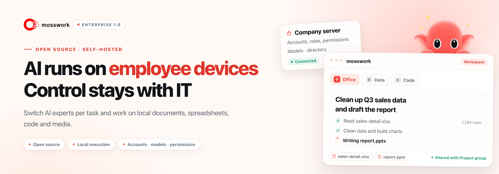

<picture>
  <source media="(prefers-color-scheme: dark)" srcset="docs/assets/readme-hero-en-dark.png">
  
</picture>

<h1>mosswork</h1>

Desktop client: <strong>mosswork</strong> · Server: <strong>moss-server</strong>

<strong>AI runs on employee devices. Accounts, models and permissions stay with IT.</strong>

  
  
  
  
  

  <a href="docker/enterprise/README_EN.md">Deployment</a> ·
  <a href="docs/enterprise-client_EN.md">Employee guide</a> ·
  <a href="docs/user-guide_EN.md">Quick start</a> ·
  <a href="CONTRIBUTING_EN.md">Contributing</a> ·
  <a href="README.md">中文</a>

An open-source, self-hosted AI work and collaboration platform. Every employee can switch AI experts per task and have them work directly on local documents, spreadsheets, code, images, audio and video; results travel to colleagues through the company directory, direct messages and groups. Project files stay on the employee&rsquo;s computer, while accounts, models and permissions remain under company control.

## Why mosswork

| For employees                                                                                                                       | For IT                                                                                                                                | For teams                                                                                                                       |
| :---------------------------------------------------------------------------------------------------------------------------------- | :------------------------------------------------------------------------------------------------------------------------------------ | :------------------------------------------------------------------------------------------------------------------------------ |
| **One workspace, an expert per task** Documents, spreadsheets, code and media in one window, with results landing back in the project folder. | **Company resources assigned centrally** Set department expert and skill scopes and assign resources to employees, without individual provider keys. | **Results move through the directory, DMs and groups** Forward AI output to a colleague, or hand it to another expert. |

## Capabilities

| Work                                                                                                                                                                                                                                                                                                                       | Collaboration                                                                                                                                                                                                                                    | Administration and deployment                                                                                                                                                                                                                                                                                                     |
| :------------------------------------------------------------------------------------------------------------------------------------------------------------------------------------------------------------------------------------------------------------------------------------------------------------------------- | :----------------------------------------------------------------------------------------------------------------------------------------------------------------------------------------------------------------------------------------------- | :-------------------------------------------------------------------------------------------------------------------------------------------------------------------------------------------------------------------------------------------------------------------------------------------------------------------------------- |
| **Assigned experts and skills** Use administrator-assigned experts and skills, switch per task, and receive centrally maintained definition and skill updates.  **Local tasks and approvals** Read and write authorized project files, run Python and terminal tasks, and work with spreadsheets, documents and code; commands matching dangerous-command rules require approval before execution.  **Images, audio, video and search** Use configured and authorized company services for image generation and editing, video generation, speech recognition and synthesis, and web search; process media with local tools.  **Long-term memory and task records** Recall relevant memory from the server and upload pending task records after reconnecting, without repeating completed operations.  **Company knowledge bases** Browse assigned or company-wide shared material and select knowledge bases in chat to search internal documents. | **Company directory** Find colleagues by organization and see who is online.  **Direct messages and groups** Company, department and project groups with text, images and files.  **Message and result sharing** Forward messages and files between conversations; hand AI output to a colleague or another expert. | **Department and employee resources** Manage accounts, organization and roles; define department expert and skill scopes, update employee grants in bulk, and withdraw resources outside the permitted scope after transfers or scope changes.  **Model and knowledge access** Administrators maintain model services and knowledge bases, assigning available models and knowledge read/search permissions per employee.  **Company capabilities and configuration updates** Grant image, video, speech and search capabilities separately; notify employees of configuration updates, with change detection after reconnecting.  **Self-hosted deployment** Operate services, accounts, conversations and knowledge yourself, with server workspace isolation plus backup and recovery tools.  **Server extensions** Scheduled tasks, multi-platform IM channels, connectors (OAuth + MCP), plugins and ACP coding-tool integration. |

Server extensions (scheduled tasks, multi-platform IM channels, connectors, plugins and ACP) depend on deployment, permissions and isolation policy; the local client does not load external connectors or ACP. See the [employee guide](docs/enterprise-client_EN.md).

## Use cases

- **Office work and research**: organize spreadsheets, summarize material, and produce reports and everyday documents.
- **Development and project work**: work with local code and files, run project scripts, analyze logs and troubleshoot.
- **Content and media production**: generate or edit images, process audio and video, and keep results in the project folder.
- **Team knowledge and collaboration**: reuse experts and skills, search company material, and discuss or share results with colleagues and groups.

## How it works

| Location          | Responsibility                                                                                                        |
| :---------------- | :-------------------------------------------------------------------------------------------------------------------- |
| **Company server** | Accounts and resource grants, model access, expert and skill configurations, knowledge retrieval, long-term memory, conversations and internal messaging |
| **Employee computer** | Task tools and local project files and results                                                                        |
| **Model services** | Company-configured internal or external inference, image and video generation, speech processing and related capabilities |

> [!NOTE]
> Local execution still connects to company services and their configured models; task context and tool results are sent to these services as needed. Local tools run with the employee&rsquo;s OS permissions, and a project folder is not an OS sandbox. Viewing history across devices does not synchronize project files. See the [employee guide](docs/enterprise-client_EN.md) for data boundaries and limitations.

## Getting started

Current version: **0.0.1**. Download the mosswork client from [Releases](https://github.com/sudoprivacy/mosswork/releases): macOS ARM64 DMG or Windows x64 EXE. Deploy the moss-server Docker images with the [one-command deployment guide](docker/enterprise/INSTALL.md) (Chinese). Source builds are covered in the [desktop build guide](desktop/README.md).

If GitHub downloads are slow, use the [Quark Drive mirror](https://pan.quark.cn/s/6da75d82a576) and choose the client version matching your server.

| Administrator: deploy and configure                                                                                                                                                                                                                  | Employee: sign in and work                                                                                                                                                                     |
| :--------------------------------------------------------------------------------------------------------------------------------------------------------------------------------------------------------------------------------------------------- | :--------------------------------------------------------------------------------------------------------------------------------------------------------------------------------------------- |
| 1. Prepare a **Linux + Docker Engine + Docker Compose** host. 2. Follow the [deployment guide](docker/enterprise/README_EN.md) to initialize the deployment and configure models and company services. 3. Create accounts and departments, assign experts, skills, available models and knowledge bases, and enable company capabilities as needed. 4. Distribute matching clients and validate one employee end to end. | 1. Install the company client and enter the server address from your administrator. 2. Sign in with your company account and confirm the local working folder. 3. Choose an assigned expert and model, then describe the file or project task. 4. Review the result and share it with colleagues, groups or another expert. |

Employees have no model access by default. An administrator must assign at least one available chat model before first use; adding a provider alone does not grant access.

For client builds see the [desktop instructions](desktop/README.md); for detailed steps see the [employee guide](docs/enterprise-client_EN.md).

## Documentation

| Document                                                                                                              | Contents                                                    |
| :-------------------------------------------------------------------------------------------------------------------- | :---------------------------------------------------------- |
| [Deployment and recovery](docker/enterprise/README_EN.md)                                                                | Prerequisites, installation, upgrades, backups and recovery |
| [Employee quick start](docs/user-guide_EN.md)                                                                            | First login, experts and everyday tasks                     |
| [Employee guide](docs/enterprise-client_EN.md)                                                                           | Tasks, results, supported scope and data boundaries         |
| [Contributing](CONTRIBUTING_EN.md) / [Desktop builds](desktop/README.md)                                                 | Development setup, source builds and client packaging       |
| [Architecture](docs/architecture.md) / [API](docs/api.md) / [Communication service](services/communication/README.md) | System structure, interfaces and company messaging          |
| [Update procedures](docs/updates_EN.md)                                                                                  | Configuration changes, server upgrades and client updates   |
