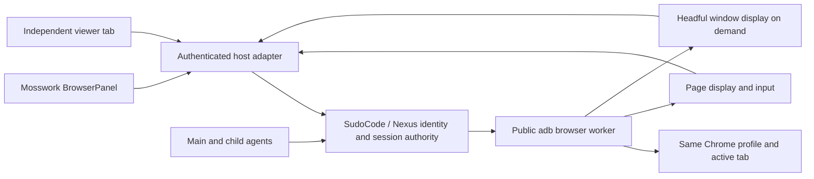

# Browser sessions

## Product contract

Mosswork preserves its frontend and desktop UX. Desktop and WebUI share the
React browser view, address bar, tabs, input hooks and connection state. A remote
viewer displays the browser that executes the task. It does not open a separate
copy of the website in the viewer's own profile.

The production management authority is SudoCode/Nexus: identity, grants,
sessions, agent runs and A2A stay there. The public
[`ai-dev-browser`](https://github.com/sudoprivacy/ai-dev-browser) worker owns
browser execution, profiles, transport and display adapters. Mosswork connects
these authorities to its UI. This contract does not establish that the complete
production adapter has been delivered.



The viewer may run in any supported local browser. Viewing a cloud Chrome
session does not require Chrome or an extension on the user's device.

## Execution and display matrix

Execution mode and viewing surface are separate choices.

| Execution | BrowserPanel | Independent viewer | Complete browser window |
| --- | --- | --- | --- |
| Local standalone Chrome through CDP | Actual compiled chat panel edits the same unsubmitted draft through local HTTP/WS | Actual compiled viewer covers refresh, two viewers, tabs and native Stop/continue | Native Chrome window; desktop-shell acceptance pending |
| Existing personal Chrome through extension | Requires the public worker adapter | Requires the public worker adapter | User's existing Chrome window |
| Cloud managed Chrome through extension | Requires canonical worker/session integration | Same cloud session through the authenticated host | Public worker window transport; Mosswork integration pending |

The local compatibility adapter currently uses `moss-browser` and the public
adb control primitive. It qualifies existing browser tools and UI while the
canonical worker adapter is integrated. Its per-user `user-N` profile is not a
production organization/session grant. Avoid extending this compatibility path
into another browser service or management authority.

The internal [`BrowserWorkerClient`](../src/octop/infra/browser/worker.py)
serializes the public Worker's existing host-only protocol. Trusted composition
must supply its canonical binding, private endpoint, credential and authenticated
controller after current access checks. The client sends each action once,
refuses redirects and preserves uncertain outcomes when a reply is lost. This
transport entry does not establish native authorization or replace the local
compatibility adapter automatically. Worker credentials and private transport
replies require a host-owned projection before reaching the UI.

Headless/headful selection belongs to the model and supported capabilities.
Headful window streaming is acquired on demand. Existing-personal-Chrome
extension mode attaches to that browser; it cannot silently restart the user's
profile as a headless process. Local extension relay from a cloud host is a
separate optional capability.

## Human and AI coordination

The conversation owns interruption and continuation. Browser views have no
business-level Take/Return buttons.

1. Native Stop, including `/stop`, requests cancellation through the existing
   gateway and pauses browser operations.
2. An already sent browser operation drains before human input is admitted.
3. A newly admitted user message carries the host's control epoch. A message
   queued before Stop retains its old epoch and cannot resume the browser.
4. Continuing requires a fresh page observation. Each agent consumes that
   observation before executing another browser action; an old action is not
   automatically replayed.

The model can use native conversation and question mechanisms to request user
help. The complete question/HITL lifecycle, parent/child run identity and
production cancellation boundary still need joint integration with the
authoritative execution adapter.

### Input boundaries

- Input carries the control and target epochs of the frame actually painted.
  Receiving a JPEG is insufficient: decoding and painting must finish first.
- Old connections and late image decodes cannot replace a newer view.
- Navigation, tab changes and viewport resizing invalidate old coordinates.
- A requested target change immediately fences subsequent input. An old frame
  already in flight cannot re-enable controls; the new target must be painted.
  The UI shows an updating indicator and does not replay rejected input.
- CDP metadata reads share the operation barrier with tab switching and capture.
  Background stream failures produce an error/status update.
- Attaching a viewer at the browser's existing size does not resize or retarget
  it. Opening a second same-size viewer must not invalidate the first one's input.
- Input releases retain their last displayed version after a rejected target
  change, allowing held keys to drain without replaying the rejected action.
- Held pointer buttons, physical keys and IME composition block AI continuation.
  A second viewer cannot interleave a held input sequence.
- Disconnect releases that viewer's held input and retains human ownership.
- Recovery advances epochs and keeps AI paused. A restart during held input
  requires explicit browser shutdown before input resumes. The journal stores
  a pending-input boolean, not typed keys or composition text.
- A failed browser operation produces an error and a fresh session snapshot.

Arbitrary shell or raw CDP access is outside this adapter's enforcement boundary.
Production must route browser capabilities through the canonical worker and
prevent a second control path. External Chrome navigation, reconnect ownership,
the profile/journal volume lifecycle and tenant grants require production
acceptance.

`ProfileControl.run_ai(..., before_effect=...)` accepts the managed host's
current authorization assertion inside the shared input barrier, after earlier
operations drain and before page observation or input. The assertion succeeds
only by returning `None`; refusal or malformed completion sends no action.
Stop during an awaited assertion invalidates the unsent action. The host derives
this callback from its actual current actor/session/resource grants; tool
arguments and browser epochs cannot supply it. The legacy harness may omit it.
The managed native-tool registration and atomic native effect fence still need
the production execution provider.

## Acceptance

The developer entries exercise actual Chrome and connected workflows:

```sh
uv sync --locked
npm --prefix dashboard ci
npm --prefix dashboard run build
uv run --locked python tools/accept_browser_control.py --chrome /path/to/chrome --output /new/output/core
uv run --locked python tools/accept_browser_worker.py --chrome /path/to/chrome --output /new/output/worker
uv run --locked python tools/accept_browser_viewer.py --chrome /path/to/chrome --output /new/output/viewer
```

[`accept_browser_control.py`](../tools/accept_browser_control.py) covers the real
tool/middleware, cancellation/draining, stale input, Unicode drafts, held input,
fresh observations, unsupported operations and restart behavior.
It also holds a real tool operation while a queued grant is revoked, rejects a
malformed authorization result, and presses Stop while the host check awaits.
The authorization callbacks in this entry are fixtures, not production grants.

[`accept_browser_worker.py`](../tools/accept_browser_worker.py) runs the
published Worker and real Chrome through the internal host client. It checks
explicit launch mode, two viewers, trusted Unicode input, binding/version
refusals, actual agent/human input exclusion and one submission with the original
cookie. Separate HTTP counterexamples verify that redirects, explicit refusal,
malformed responses and lost replies never trigger another request or expose a
credential. Its identities are fixtures; it does not qualify native grants.

[`accept_browser_viewer.py`](../tools/accept_browser_viewer.py) uses the compiled
dashboard, real authentication, HTTP, WebSocket and Chrome. It checks canvas
input, an unsubmitted draft across refresh and a second viewer, tabs, native
conversation Stop/continue, the chat BrowserPanel and a 390×844 mobile Chromium
viewport with touch and Unicode input. It also verifies typed browser API
schemas and refuses a live receipt if its runtime source changes during the run.
It also pins every compiled dashboard file before and after the run and checks
actual HTML, JavaScript and CSS response bytes against that manifest. The
receipt hashes `dashboard-content-manifest.json` so the tested frontend can be
retained with its backend source and lock input. This identifies the served
artifact; it does not attest to the original frontend build or replace release
qualification.
The mobile check is emulation; it does not qualify iPhone, iOS or an OS keyboard.
Its model uses the existing test harness. No cloud
credential or provider key is substituted for a production user grant.

The viewer entry also accepts a compiler-owner-exported graph fixture. Pin its
manifest SHA-256; all exported file hashes are verified before and after use.
The HTML is served unchanged. The extra journey navigates through the actual
viewer address bar and exercises exact label selection, field expansion,
language switching and zoom against canonical object IDs:

```sh
uv run --locked python tools/accept_browser_viewer.py --chrome /path/to/chrome \
  --output /new/output/graph --review-fixture /path/to/compiler-export \
  --review-manifest-sha256 <verified-manifest-sha256>
```

The same journey opens a source record page through the remote viewer. It
requires the renderer's exact original resource/revision/digest request, checks
the fixed response bytes and displayed values, then returns from a record cell
to its canonical field. The graph HTML is served unchanged and contains no
preloaded rows. This read uses synthetic fixture data; it is not an authorized
production gateway. A missing or pending comment host remains unavailable and
cannot count as submitted-comment evidence.
The record-page duration includes opening the page, expanding rows and checking
their values. It is not a single-click latency measurement. These graph cases
require both fixture arguments; a run without them covers the base viewer.

This journey records loopback input-to-effect time and an observation after two
subsequent frames plus a viewer animation frame. The latter includes that wait;
it does not measure the first visible effect or isolate transport latency. A synthetic compiler
fixture does not qualify a customer's model, authenticated ShareOne comments,
durable notification delivery or WAN latency. The pending comment host remains
pending; no stub submission is treated as a real comment.

The browser CI runs these entries on Linux and Windows using Playwright's real
Chromium. Its graph input is the corresponding published PR5 fixture, selected
by platform and exact archive, parent and manifest digests in
[`accept_browser_fixture.json`](../tools/accept_browser_fixture.json). The
[`intake tool`](../tools/accept_browser_fixture.py) checks the parent's successful
checks, fixture emission event, original pointer and all eight payloads before
staging unchanged HTML into a new directory. It starts no compiler or worker.
The viewer receives `--review-intake /staged/intake.json` and rechecks that
parent/payload binding before and after graph I/O. CI retains this intake beside
the new browser receipt. Linux and Windows retain separate endpoints and
revision/digest pairs. An expired or mismatched artifact fails intake; it cannot
fall back to a freshly generated fixture or inherit an earlier UI receipt.
These published fixtures qualify a component input, not the final integrated
application/image. The previous fixture receipts retain their original scope.

A local Chrome run, a model-stub run and a physical-phone run are
different evidence. Full desktop-shell, actual model, managed extension,
Sudograph comments, WAN latency, physical iPhone and production rollout/rollback
acceptance remain required for the complete matrix.
