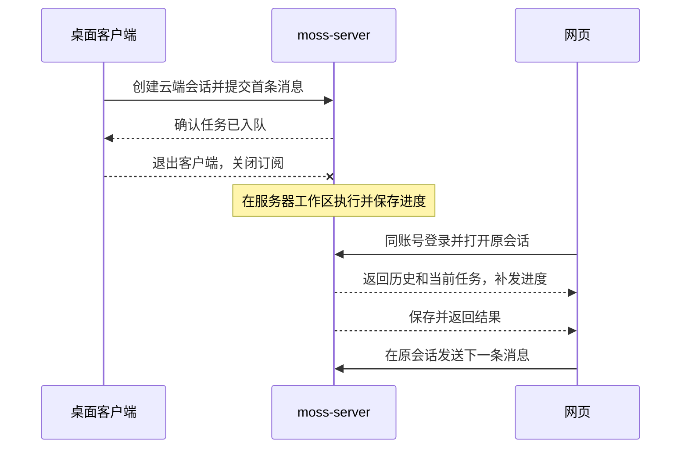

# 桌面发起云端任务，网页继续原会话

桌面端新建「云端任务」后，由当前登录的 moss-server 执行。用户退出桌面客户端后，可以从浏览器登录同一台服务，用同一个企业账号打开原会话。任务仍在运行时，网页补齐进度并继续接收结果。任务完成后，用户可查看历史与产物，并在原会话里继续提问。

## 使用流程

1. 在桌面「新建会话」菜单选择「云端任务」，进入带「云端执行」标记的会话。选定专家后，像平常一样发消息和上传附件。执行位置在创建会话时确定。
2. 服务端接收首条消息并入队后，桌面显示「已提交」或当前执行状态。退出客户端只结束当前界面的订阅，服务端继续执行。关闭前还没收到提交确认时，可在网页打开原会话核对。
3. 从网页的现有会话列表打开同一个专家下的原会话。排队或运行中显示当前进度，等待审批时显示原审批卡片，完成后显示历史和服务端产物，并可直接发下一条消息。用户主动点击停止时，桌面和网页都可以取消原任务。

云端任务使用服务器工作区和服务器上授权的模型、工具。本机文件需要先上传，上传完成后随消息提交。服务器停机或执行结果未知时，界面沿用现有任务状态，提示核对结果并避免重复执行。

## 实现方案

### 创建与路由

- 桌面用账号身份调用现有网页会话创建接口 `POST /api/agents/{agent_id}/threads`，沿用同一个 `thread_id`。消息、历史、审批、停止和文件操作根据会话的 `execution_location` 走对应路径。云端会话复用网页的 API 和 WebSocket，桌面原生代理已支持转发这两类请求。[会话创建接口](../../src/octop/api/routers/chat/history.py) · [桌面代理](../../desktop/src/internal/companyui/server.go)
- 服务端接通已有的 `threads.execution_mode` 字段。网页接口创建 `server` 会话，原生本机接口创建 `local` 会话，创建响应、列表和历史将其映射成现有的 `execution_location`。服务端入队和本机领取时，在现有事务中校验会话模式及所属账号，确保空会话从创建起就使用选定位置。以旧设备绑定识别历史本机会话，验证旧桌面创建和首次执行本机任务的兼容性。[已有迁移](../../src/octop/infra/db/migrations/031_thread_execution_mode.sql) · [本机领取](../../src/octop/infra/db/repos/company_runtime.py) · [服务端入队](../../src/octop/infra/db/repos/execution.py)
- 桌面按会话类型决定是否启动本机运行时及采用哪套发送、订阅和取消逻辑。云端会话直接使用网页上传和服务端产物下载。默认的新建入口仍供日常本机任务使用，「云端任务」是明确的创建选项。[会话 API](../../dashboard/src/api/modules/mossworkThreads.ts) · [聊天状态](../../dashboard/src/pages/Chat/hooks/chatStore.ts) · [会话界面](../../dashboard/src/pages/Chat/index.tsx)

### 从另一端接上原任务

- 会话历史返回当前服务端任务的执行 ID、状态和事件序号。摘要在读取消息历史前获取。任务恰好完成时，网页按执行 ID 补读终态，或在发现会话已空闲时重新拉取历史。分离式部署从数据库补读任务事件，单体部署从内存补读在途任务的近期进度，完成结果由服务端历史提供。[历史接口](../../src/octop/api/routers/chat/history.py) · [当前任务查询](../../src/octop/infra/db/repos/execution.py) · [单体进度缓存](../../src/octop/infra/gateway/ws/ws_hub.py)
- 网页首次打开时从服务器取得执行 ID，通过现有 WebSocket 回放已提交事件，再接收后续进度。浏览器已有同一任务的游标时从该游标接上。历史里已经显示的消息按稳定消息标识合并，事件按执行 ID 和游标去重。终态到达后以服务端历史和产物更新会话，保留已加载的历史页。任务在历史加载与订阅之间完成时，仍能按原执行 ID 读取最终事件。[事件回放](../../src/octop/api/routers/chat/ws.py) · [前端事件游标](../../dashboard/src/pages/Chat/utils/executionCursor.ts)
- 桌面为一次发送生成一个 `client_request_id`。重新打开会话只加载已有历史和执行状态。桌面与网页同时操作时，沿用服务端的会话占用、审批及取消规则。等待审批时展示原审批，确认后继续原任务。任务完成后，新消息在同一个 `thread_id` 下创建下一次执行。[共享执行协议](execution-contract.md) · [状态、回放和取消接口](../../src/octop/api/routers/executions.py)

## 实施和验收

1. **服务端**接通创建、读取和执行位置校验，补齐按会话获取执行 ID 的能力。验收账号隔离、空会话的执行位置，以及排队或刚完成时从另一端打开会话。
2. **桌面与网页**接入「云端任务」入口和跨端订阅，覆盖文字、附件、审批和停止。用两套独立登录会话验证同一个 `thread_id` 在两端可见，核对重连续传和消息去重。
3. **实际客户端验收**用桌面安装包提交可持续运行的任务，收到确认后彻底退出客户端。用一个全新的浏览器会话登录，打开原会话，检查以下结果。

   - 任务仍运行时能看到已产生的进度，并收到后续输出。
   - 任务已经结束时能直接看到结果和下载产物。沿用其上下文追问后，回答仍出现在原会话。
   - 任务等待一次人工确认时，网页里的确认能继续原任务。停止操作能在双方重新打开会话后读到一致的状态。
   - 提交应答丢失但服务端已经入队时，重开能找到已有任务。请求尚未到达服务端时，原会话显示未提交，可由用户重新发送。任务刚结束时重开，最终结果只展示一次。
   - 其他账号即使知道会话或执行 ID，也无法读取或控制任务。

预计改动集中在 Dashboard 和 moss-server 的会话接口、执行模式判定及订阅。按现有企业账号部署设计，桌面壳复用现有转发能力。桌面套件内置 Dashboard，交付时需同时部署配套服务端和网页构建，并重新打包客户端。采用 Canonical 身份的部署需另外确认会话接口与运行授权的接入方式。[企业桌面前端交付方式](../../desktop/README.md) · [Canonical HTTP 路由边界](../../src/octop/api/middleware/setup_lockdown.py)
