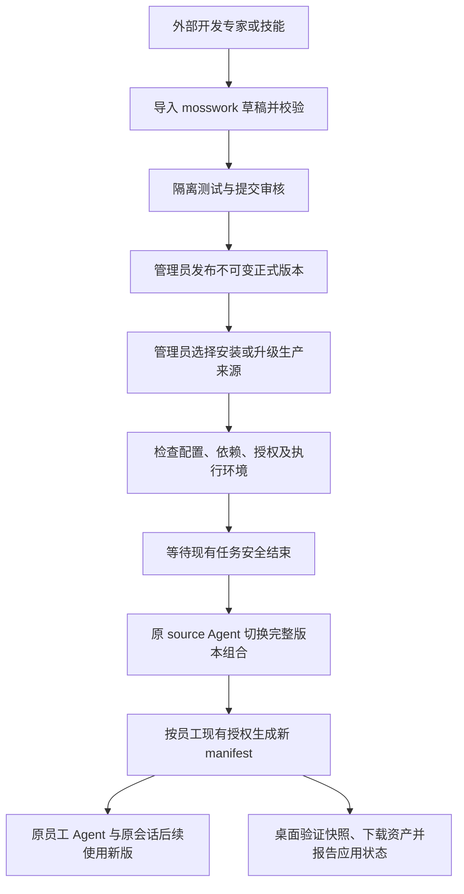

# mosswork 内置专家与技能市场适配评估

日期：2026-11-11。性质：基于当前工作区的静态源码评估与实施建议，不表示下述目标能力已经实现。本文不改变现有运行协议或发布流程。

## 1. 结论

**可以在 mosswork 内落地此前的内置专家与技能市场方案，建议复用现有平台扩展。不能通过替换腾讯市场地址、直接嵌入 skill-hub 或复制原型就完成。**

mosswork 已保留专家模板发布、技能包、管理员资源来源、员工专家分配、不可变运行快照、原实例同步和桌面任务分发，具备实现该方案的主要基础。新增工作的核心是：资源级版本库、草稿与审核、固定版本依赖、安装绑定，以及连接现有执行协议的升级协调。

需要针对本项目明确以下边界：

1. 服务端与桌面是不同执行环境。服务端已有 MCP 组装路径；企业桌面当前明确不加载外部连接器，且禁用了自动子专家加载，不能宣称任意服务器专家导入后可在桌面运行。
2. 当前“发布专家”刷新同一份模板；技能包也会原地修改文件。两者都不是不可变语义版本市场。
3. 保存源内容后自动形成资源快照，与“开发者提交、管理员审核上架”是不同流程。开发草稿必须与生产来源隔离。
4. 旧 Agent 和会话可以保留；桌面旧任务目前会因资源修订变化而被请求取消，需要调整内容升级的排空规则。
5. 可以继续交付一个离线安装包，但该包启动现有多个容器；桌面客户端需要配套分发。市场离线还要求模型、运行依赖及业务接口在内网可用。

推荐形态：**moss-server 内置一个市场模块，复用现有数据库、持久卷、登录、管理界面与员工授权；不新增必需的 skill-hub 服务。**

## 2. 当前实现与适配差距

下表中的“已有”表示源码存在对应路径，不代表本次已完成运行验收。

| 能力 | 当前实现及证据 | 适配结论 |
| --- | --- | --- |
| 专家模板发布与安装 | [published_creation.py](../../src/octop/infra/agents/experts/published_creation.py) 的 refresh/install；[published_experts.py](../../src/octop/infra/db/repos/published_experts.py) 保存模板元数据 | 可复用导出、预览和初始化；增加资源与正式版本，刷新不再覆盖历史版本 |
| 技能包维护 | [skill_package_store.py](../../src/octop/infra/skills/skill_package_store.py) 的 write_skill；[skill_packages.py](../../src/octop/infra/db/repos/skill_packages.py) | 可复用文件规范化与包处理；正式版本应写新对象，不能继续原地覆盖 |
| 资源复制限制 | 技能包 copy_policy 为 snapshot/lock/deny | 保留现有含义；它不是“固定版本/跟随推荐”的升级策略 |
| 服务端 MCP | [manager.py](../../src/octop/infra/agents/manager.py) 组装用户获准的 mcp_server_configs | 可衔接服务器执行；安装者仍须具备对应连接器授权 |
| 员工授权与实例 | [expert_access.py](../../src/octop/infra/users/expert_access.py) 的 instantiate；[026 迁移](../../src/octop/infra/db/migrations/026_expert_assignments.sql) | 保留 source_agent_id 和 instance_agent_id，可在原员工实例上更新 |
| 员工定义与技能同步 | [employee_resources.py](../../src/octop/infra/users/employee_resources.py) 的 snapshot/prepare；[managed_resources.py](../../src/octop/infra/users/managed_resources.py) 的 DEFINITION_FILES | 可复用受管范围及个人资料保留规则；补充版本映射、完整切换与恢复 |
| 不可变来源快照 | [source_publication.py](../../src/octop/infra/users/source_publication.py) 的 mutation/_publish | 可复用捕获、摘要、CAS；自动保存发布不能充当管理员审核 |
| 运行清单与事件 | [resource_manifests.py](../../src/octop/infra/db/repos/resource_manifests.py) 的 publish | 复用 manifest、代次和 outbox；它们不代替市场版本表，outbox 也不等于全部客户端已收到更新 |
| 桌面缓存与任务快照 | [company_runtime/service.py](../../src/octop/infra/company_runtime/service.py) 与 [runtime.py](../../src/octop/infra/company_runtime/runtime.py) | 可复用摘要校验和任务固定资产；新增市场版本标识、适配检查及应用确认 |
| 客户端更新提示 | [client_config.py](../../src/octop/infra/users/client_config.py) | 复用通知与修订查询；配置修订变化不代表某台设备已经执行新版本 |
| 离线发行 | [compose.release.yml](../../docker/enterprise/compose.release.yml)、[INSTALL.md](../../docker/enterprise/INSTALL.md) | 复用离线镜像包和现有数据卷；新增市场种子包、依赖清单与断网验收 |

现有管理员权限、资源拥有者、员工分配和部门范围应继续作为授权基础。新市场不另建账号系统，也不能让员工通过“从市场安装”绕过 assigned_only 等现有限制。

## 3. 在 mosswork 中串起完整流程

例如，“设备巡检专家”1.0.0 已安装到管理员生产来源 A，员工获配实例 B，并在会话 T 中使用。开发者提交 1.1.0 后：

1. 管理员审核 1.1.0，发布正式版本；A、B、T 此时都不变化。
2. 管理员为 A 确认升级计划，检查依赖、现场配置和关联员工范围。
3. 在允许切换时更新 A 的受管版本组合，不新建 A，也不删除 B。
4. 员工下一次使用前生成并应用获准的新运行清单；桌面端按新清单取得资源。
5. B 和 T 的身份、历史、员工资料和业务文件保留；后续执行使用 1.1.0。

“原对话同步更新”应按第 5 步理解：**更新后续执行使用的定义和技能，不重写历史消息，不追溯执行旧消息。** 旧检查点可能保留旧提示、工具调用或执行状态，必须增加跨版本恢复测试。遇到不兼容状态，应保留历史并明确提示重建执行上下文，不能静默清空会话。

## 4. 必须调整的实现边界

### 4.1 三类版本不能混用

| 对象 | 示例 | 用途 |
| --- | --- | --- |
| 市场资源版本 | 巡检专家 1.1.0 | 人能理解的正式发行、依赖和回退单位 |
| 获准运行清单 | 某员工实例第 N 代 manifest 及 SHA-256 | 固定该实例当时获准的定义、技能、配置引用与文件 |
| 桌面任务快照 | 当前 snapshot.version 摘要 | 校验和缓存该任务的实际执行内容 |

当前桌面 snapshot.version 是 SHA-256，不是 1.1.0 这样的业务版本。市场应增加稳定 resource_id、version_id 和语义版本，记录其与 source Agent、manifest、任务快照的对应关系。

技能是最小版本化单元，现有技能包继续作为组织容器；专家版本固定其引用的技能版本。对同名不同内容、依赖冲突应显示冲突，不能仅按目录名自动合并。

### 4.2 草稿不能修改生产来源

现有源发布中间件和 SourcePublication.mutation 会在成功保存后发布源快照。此机制解决一致性，不提供人工审核。

新市场需要独立草稿内容与测试实例。提交时冻结文件、摘要、依赖及运行声明；管理员审核的是冻结内容。发布后编辑应形成下一版草稿，不能修改已发布对象。

只有经批准的明确安装或升级操作才能改变生产来源绑定。既有非市场资源的保存同步可保留，但不能成为受管市场内容绕过审核的写入口；受管定义及文件应只读，定制需要显式脱离跟随或创建个人副本。

还需覆盖默认单体与分角色模式：[server.py](../../src/octop/infra/server.py) 目前仅在 worker 角色启用 SourcePublication，而发行 Compose 默认启动单体。不能只给 worker 增加新市场读取路径，就认为离线发行包已支持。

### 4.3 保持来源与实例身份稳定

员工分配以 source_agent_id 关联管理员生产专家，assigned_expert_instances 保存其员工实例。升级同一个专家时必须保留这两个身份。

不采用“卸载旧专家、安装新版专家”模拟升级，否则容易产生新来源、重复员工实例及会话关联断裂。现有 published_expert_id 可作迁移线索，但不能代替包含当前版本、目标版本、策略和结果的安装绑定。

一期建议按生产来源统一决定版本，员工实例跟随其获配来源。若要同一来源下不同员工长期固定不同版本，需要扩展员工级版本解析与 manifest 组成逻辑，现有来源映射本身不具备这一能力。

### 4.4 内容升级与撤销授权分开处理

当前 company_runtime/service.py 在任务保存的 resource_revision 与员工当前修订不一致时，会拒绝 active 请求，或向旧任务发起取消。这有明确的现有测试覆盖，不能直接描述为“旧任务正常完成”。

目标规则应区分：

- 普通内容升级：运行中的任务固定完整旧版本到安全结束，随后切换；新任务采用完整新版本，不能混用文件。
- 撤销授权、账号停用或执行停用：继续实时阻止执行，不因旧任务固定版本而保留已撤销权限。
- 审批等待、取消中、结果未知：复用现有共享执行协议，保留占用并显示待处理原因，不能当作空闲直接升级。

目前 employee_resources.prepare 对受管目录执行删除、上传和定义同步；不可变 manifest 的原子提交不代表这些工作区操作已经具备整体失败回退。应增加完整版本组合的暂存、持久阶段、验证、切换与恢复，工作区内容继续经 BackendWorkspace 操作。

升级协调必须接入 [共享执行协议](execution-contract.md)，以数据库任务和占用为准，不能只检查前端是否正在输出或进程内计数。普通发布、来源升级、员工应用与具体设备实际使用应分别记录状态。

### 4.5 导入可行，但需要确定的包契约

开发者可以在其他地方开发，再通过离线包导入。这里的“直接导入”应指进入校验和审核流程，而不是任意文件上传后立即可运行。

| 导入内容 | 建议处理 |
| --- | --- |
| 含 SKILL.md 的技能目录或 ZIP | 复用现有技能解析能力，生成草稿，补齐资源身份、版本、依赖和执行要求 |
| 含定义文件的专家包 | 导入专家草稿，解析其技能和子专家依赖，预览最终受管文件 |
| 专家内嵌技能 | 转为明确依赖，保留摘要和来源；同名不同内容由管理员确认映射 |
| 已知资源的新版本 | 在目标市场解析为原资源，验证维护权限及版本唯一性，不能仅凭同名自动关联 |
| 旧 skill-hub 导出 | 采用单独适配器导入草稿；重算文件摘要、补缺失声明，再审核发布 |

建议包声明包含 format、kind、资源身份、version、固定依赖、执行端、平台/架构、引擎兼容要求和现场配置契约。外部声明的资源 ID 不能自行获得本地资源维护权限。

不应将任意第三方“专家”视为通用格式。若它依赖其他平台的工具、专有工作流或记忆结构，仍需转换并验证。

市场导出采用明确文件白名单。当前专家导出允许 USER.md；新市场默认排除个人 USER.md、MEMORY.md、历史、检查点、凭据及业务输出。确需“用户资料示例”的，应另设显式模板，不沿用真实个人资料。

### 4.6 业务系统地址与桌面 MCP

业务系统地址是技能访问的现场 API 地址，例如厂内设备系统的接口根地址；不是市场地址、模型地址，也不是每个资源都必须填的字段。纯提示词或本地文件处理技能可以不需要业务地址。

资源版本声明“需要什么配置”，安装绑定保存该现场实际配置；密码、Token 等通过既有凭据引用授权，不打入资源包。升级时保留合法现场值，新版新增必填项时显示“待配置”并保持旧版。

对执行端应采用以下约束：

| 资源能力 | 服务端 | 当前企业桌面 |
| --- | --- | --- |
| 提示词和获准技能文件 | 可衔接现有运行时 | 可衔接现有任务快照 |
| 本地脚本 | 需匹配服务器/沙箱依赖 | 需匹配员工操作系统、架构与本机依赖 |
| 外部 MCP 连接器 | 已有配置组装路径，仍需授权 | 当前不加载，不能承诺选择后生效 |
| 自动子专家/团队委派 | 按服务端现有能力校验 | 当前禁用自动加载与委派，需标为不兼容或另行适配 |

建议一期将需要 MCP 的资源明确标为服务器执行。若必须在桌面任务中使用业务系统，应新增服务端受控工具代理，或设计获准的桌面连接协议；现有代码并不自动提供该能力。

脚本直接请求 HTTP API 是另一条路径，仍须检查员工网络可达性、配置注入、依赖和凭据来源。仅填写一个业务地址不能替代这些条件。

## 5. 推荐改造落点

| 层次 | 建议新增或调整 | 复用边界 |
| --- | --- | --- |
| 领域层 | 新增 infra/market，负责草稿、审核、正式版本、依赖、安装计划与升级作业 | 复用专家模板、技能规范化和文件对象存储，不在 HTTP router 中实现规则 |
| 数据层 | 资源、草稿/审核、不可变版本、依赖、安装绑定、升级作业/尝试与客户端应用记录 | 复用账号、组织、manifest、outbox 与共享执行记录；SQLite/PostgreSQL 迁移保持一致 |
| API | 市场查询、导入、草稿、管理员发布、安装计划、升级/回退与状态 | 继续同源 /api、现有鉴权与实际管理员校验 |
| Web 界面 | 统一资源市场，区分专家/技能；管理端增加草稿、审核、版本和关联实例 | 延续 mosswork 当前界面与权限，不嵌另一套独立管理系统 |
| 员工分发 | 正式版本绑定生产来源，再按现有分配生成员工清单 | 不增加发布者连接器或知识库授权，不暴露管理员个人配置 |
| 桌面 | 显示兼容执行端和实际资源版本，获取固定清单并记录应用结果 | 继续任务授权下载、摘要校验和现有服务端控制 |
| 发行 | 将市场元数据、不可变对象、种子包纳入既有离线包和备份恢复 | 复用 PostgreSQL 和 app 持久卷，无需新增必选服务 |

现有“腾讯市场”与本地发布库应收敛为内置市场入口。下架应保留版本和引用；现有 unpublish 删除模板记录和目录的行为不能直接作为正式版本下架实现。

离线模式还要处理 skillhub_common.py、skills_hub.py、专家市场客户端、下载器及 CLI 回退、远程图标和资源引用。只换页面或默认 host 不能保证不访问外网。

## 6. 实施顺序与交付边界

| 阶段 | 交付内容 | 达标要求 |
| --- | --- | --- |
| A：内置市场与版本基础 | 外部包导入、独立草稿、管理员审核、正式不可变版本、依赖锁定与执行兼容声明 | 同一资源能保留多个版本；不依赖腾讯市场；草稿修改不影响生产 |
| B：固定版本安装与原实例升级 | 安装绑定、现场配置、生产来源升级、员工分发、任务安全边界、失败恢复及桌面状态 | 原 Agent 和会话身份不变；完整旧版或新版可追溯；缺配置与忙碌时不强切 |
| C：规模化维护 | 跟随推荐、跨主版本确认、批量影响分析、回退、离线迁移与完整断网验收 | 可核对每个来源、员工实例和设备的实际状态；回退不恢复撤销权限 |

原需求中的“发布新版后同步原对话”至少需要 A+B。仅完成市场页面和版本列表不能算实现原需求。自动跟随与批量升级可后续交付，但安全切换、权限和失败恢复不能推迟到上线以后。

## 7. 第一版实施入口

资源包目录、声明、身份、版本、配置和交付材料的具体标准见[资源包开发规范](resource-package-development.md)。第一版提供导入草稿、冻结提交、管理员审核发布、正式版本下载、推荐和软下架；已补充“专家市场 → 选定发布版本 → 创建私有 Agent”及其固定技能依赖安装、来源记录。同时支持“技能包 → 资源市场 → 查看正式版本 → 安装独立技能包 → 专家技能页挂载”。安装保留精确依赖及来源摘要；推荐变化不覆盖已安装技能包。当前支持通用服务器资源，具体运行要求见开发规范；原 Agent/员工实例自动升级尚未完成。

当前启动流程还会将仓库内置专家库转换为 18 个专家和 42 个技能的本地正式种子，并随安装包交付；种子写入是幂等的，且不覆盖客户同 slug 资源。腾讯 SkillHub 的外部目录和下载包不作为默认种子，除非另有明确的再分发授权、许可证记录和构建期快照验收。

## 8. 验证依据与后续验收

仓库已有以下相关测试，本次仅审阅内容，未执行：

- [test_managed_resource_sync.py](../../tests/unit/users/test_managed_resource_sync.py)：包含内容更新后保留员工 USER/MEMORY/业务文件/会话、活跃调用不重建，以及桌面旧任务因资源变化被取消的测试。
- [test_resource_manifest_publication.py](../../tests/unit/users/test_resource_manifest_publication.py)：包含内容与摘要一致、存储失败保留旧指针、发布中撤权及桌面从固定清单导出的测试。

这些用例证明存在可复用的设计与回归入口，不证明新的市场版本、审核和安全升级已经具备。

实施后至少补充以下闭环验收：

1. 外部导入技能和专家，重复版本、路径越界、损坏摘要、缺依赖及不兼容执行端均能阻止发布或安装。
2. 开发者保存、提交和撤回草稿均不改变生产实例；只有实际管理员批准后才产生正式版本。
3. 1.0.0 升级 1.1.0 后保持 source/员工 Agent/会话身份，保留个人资料、记忆、历史和业务文件；后续任务使用新定义及完整依赖。
4. 普通更新时旧任务按旧版完成；撤权仍立即阻止受控调用。审批中、取消中、unknown 不得被当作空闲。
5. 切换中断、文件写失败、进程重启和并发升级可恢复，不产生半套文件或重复外部业务操作。
6. 同时验证默认发行单体与 PostgreSQL 分角色部署；桌面按实际交付的 Windows/macOS 架构验证，不能只测服务器。
7. 客户端离线期间显示待同步；重连后可验证实际使用版本，不把通知成功当成应用成功。
8. 断公网完成导入、审核、安装、业务调用、升级、备份和回退；模型与依赖使用内网已准备资源，缺失时明确失败，不静默回退公网。

本评估最初基于静态源码形成；后续第一版实施范围见第 7 节及开发规范。本文中的既有测试描述不等同于第一版实施的测试结果。新增安装链路由集成测试和浏览器验证；平台专用安装、原实例升级及上线承诺仍须以以上闭环验收为准。
